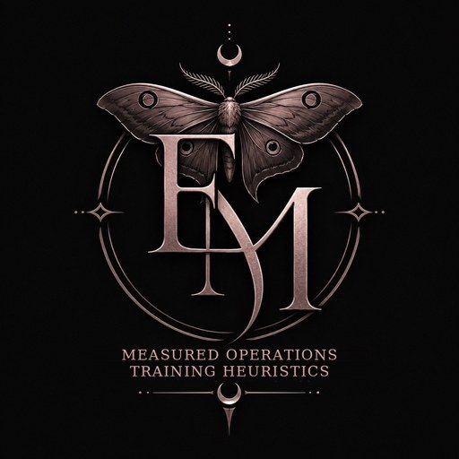
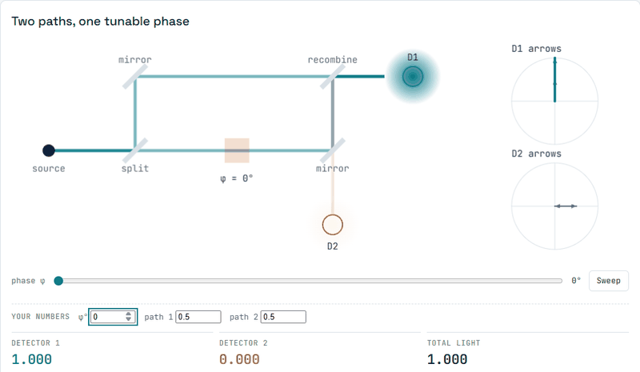
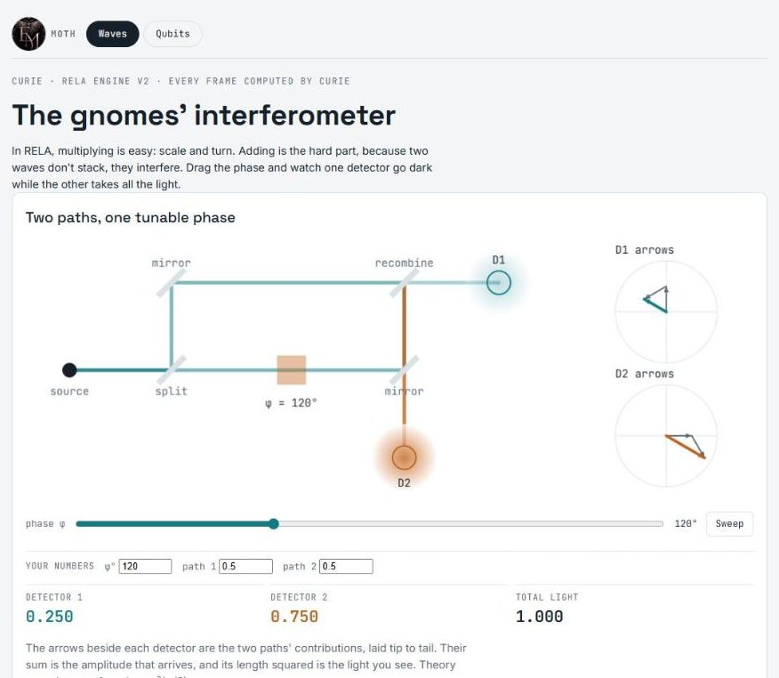
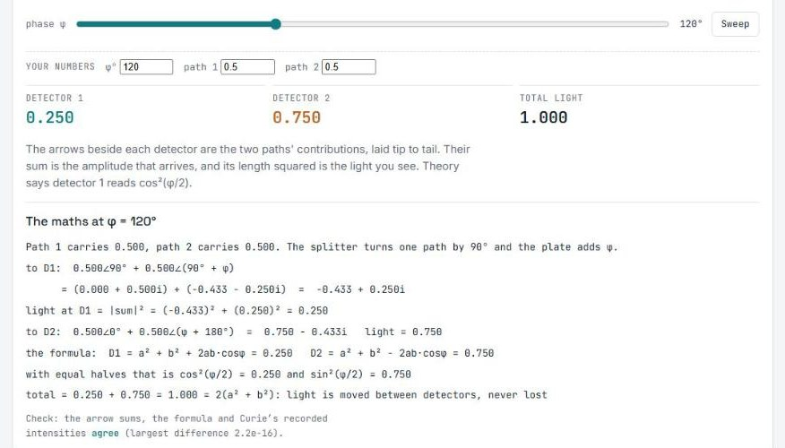
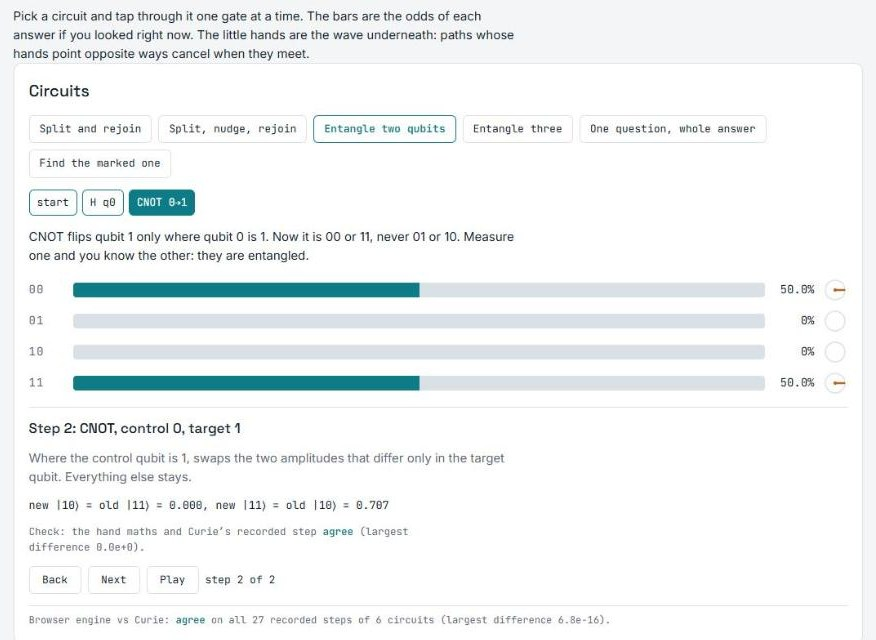
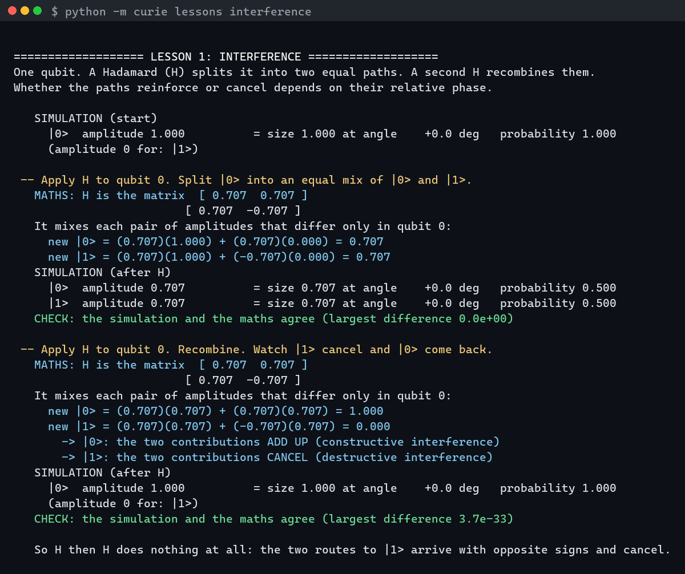

<p align="center"></p>

# Curie

*A MOTH project.*

**A quantum-computation microscope.** Curie lets you build small quantum circuits, run them, and look at
every step: what each gate did to each amplitude, where two paths interfered, and where two versions of a
circuit first stop agreeing. It is written to be read, not to be fast.



*Two paths, one tunable phase. As the phase turns from 0° to 180°, the two arrows arriving at detector 1 swing apart until they cancel, and every bit of the light moves to detector 2. The total never changes. That cancellation is interference, the same effect every quantum algorithm is built on. Open `viewer/bench.html` and drag the slider yourself.*

Curie is **not** a general-purpose simulator. It holds every amplitude of the state (so at most 12 qubits),
it has no noise model, and it does not talk to quantum hardware. If you need speed, many qubits, or noise,
use Qiskit, Cirq or QuTiP. If you want to see *why* a circuit does what it does, Curie is for that.

## What it looks like

The wave bench (`curie bench`, or open `viewer/bench.html`): tune a phase and watch one detector go dark.



Every wave writes out its maths as you change it, and checks the arithmetic against Curie's own numbers.



The Qubits tab steps through circuits gate by gate. Here a CNOT has just entangled two qubits.



In a terminal, the lessons print the simulation and the hand maths side by side, and check they agree.



## Install

**The easy way:** double-click **Start Curie.bat** (Windows) or **start-curie.command** (Mac). A
small menu opens the wave bench in your browser, which needs nothing installed, or runs the lessons
and tours, which need Python 3.10 or newer. If Python is missing, the menu says where to get it.
Option 4 checks Curie against Qiskit and Cirq: it asks first, then downloads them into a private
`.venv-xcheck` folder and runs every test, including the cross-checks.

**With pip:**

```
pip install .                 # from the repository folder; Python 3.10 or newer, no dependencies
curie lessons                 # the three lessons, maths beside simulation
curie bench                   # open the wave bench page in your browser
curie demo q2                 # a tour: q1 entanglement, q2 programs, q3 the microscope
```

`pip install .[xcheck]` also installs Qiskit and Cirq for the cross-check tests. Without installing
anything, `python -m curie lessons` works from the repository folder, and `viewer/bench.html` opens in
any browser.

## Quickstart

From the repository folder, with Python 3.10 or newer and nothing to install:

```python
import random
from curie.entangle import bell, chsh_value
from curie.qstate import sample

state = bell('phi+')
print(state.probabilities())
print(sample(state, 10, random.Random(2024)))
print(f'{chsh_value(state):.6f}')
```

Output:

```text
[0.4999999999999999, 0.0, 0.0, 0.4999999999999999]
{'00': 6, '11': 4}
2.828427
```

That last number is the CHSH value of a Bell pair: 2√2, the most any quantum state can reach, against the
limit of 2 for any classical explanation.

Longer tours: `python -m curie.demo_q1` (entanglement), `python -m curie.demo_q2` (programs),
`python -m curie.demo_q3` (the microscope).

## Lessons: every step, shown as the simulation and as the maths

```
python -m curie.lessons                 # all three
python -m curie.lessons interference    # or: entanglement, grover
```

Each lesson walks through a circuit one step at a time and prints that step twice: what Curie's engine
produced (every amplitude as a size and an angle, with its probability), and the same step worked by hand
(the gate's matrix, which amplitudes it mixes, the arithmetic, and whether the contributions reinforced or
cancelled). The hand column is computed independently in plain complex numbers, and every step checks that
the two agree. If they ever disagree, the lesson stops rather than teach a wrong answer, and the tests prove
that check can fail by corrupting the simulation on purpose.

- **Interference**: H, H returns to |0⟩, because the two routes to |1⟩ cancel; one phase flip in between
  moves the answer to |1⟩.
- **Entanglement**: H then CNOT makes a Bell pair, and the lesson shows the arithmetic that proves no pair of
  single-qubit states can produce it.
- **Grover**: four items, one marked; the oracle hides the mark in a phase, and diffusion turns that phase
  into probability 1. It also explains a global phase of −1 that the gate sequence introduces, which no
  measurement can see.

## What is in it

**States and gates** (`curie.qstate`, `curie.entangle`): n-qubit states up to 12 qubits, single-qubit gates,
controlled gates, CNOT, CZ, SWAP, Ry rotations, measurement and sampling, Bell and GHZ states, a
product-state check, and CHSH both exactly and by sampling. Qubit 0 is the most significant bit: `100` is
amplitude index 4. Equality distinguishes global phase.

**Programs** (`curie.programs`): circuits are plain lists of printable operations. Included: teleportation
(each measurement branch can be forced, so you can inspect all four), Deutsch-Jozsa (it checks the promise
that the function is constant or balanced), Grover search, and multi-controlled Z.

```python
from curie.programs import teleport, deutsch_jozsa, grover_probability

state, outcomes = teleport(1, 0, forced={'m0': 0, 'm1': 1})
verdict, probability = deutsch_jozsa(lambda x, y: x ^ y, 2)
p = grover_probability(3, marked=5, k=2)
```

Oracles and multi-controlled operations act on the amplitudes directly; they are not decomposed into a
hardware gate set.

**The microscope** (`curie.trace`, `curie.verify`, `curie.diff`):
- `curie.trace.tracing()` records every circuit step and every interference event as JSON, and
  `curie.trace.explain` summarises it in plain words.
- `curie.verify` replays a trace independently, using ordinary complex arithmetic rather than Curie's own
  engine, and reports the first step whose recorded output does not follow from its input. It checks the
  state steps; it does not authenticate the interference events themselves.
- `curie.diff` takes two circuits and finds the first checkpoint where their states differ, ignoring global
  phase.
- Measurement and conditional operations cannot be traced yet.

**Fourier by interference** (`curie.fourier`): a discrete Fourier transform computed only by interference,
with no FFT, plus measurement under the Born rule.

**The wave bench** (`viewer/bench.html`): a page that animates the engine's own output, including a Qubits
tab with six traced circuits and a build-your-own circuit. Open the file in a browser; `viewer/build_bench.py`
regenerates it.

## How it computes: RELA

Curie is written in **RELA** (Relational Event and Amplitude Mathematics): every amplitude is a magnitude
and a phase, multiplying is native, and adding happens only through interference. It is chosen because it
makes the arithmetic easy to read, not for speed. We also tested whether RELA does anything better than
standard mathematics; five ideas were put to a fair test, and none survived. The full research, with the
results table, proofs, reviews and measurements, is in [docs/RELA.md](docs/RELA.md).

## How it is checked

- **Against Qiskit.** `tests/test_xcheck_qiskit.py` compares Curie's state vectors with Qiskit's exact
  `Statevector` on 300 random circuits; they agree to about 1e-15 (floating-point rounding). Deutsch-Jozsa
  and Grover agree too. The check has teeth: a deliberately wrong qubit order is caught in 216 of 233 cases.
  It is skipped when Qiskit is not installed.
- **Against Cirq, a second independent simulator.** `tests/test_xcheck_cirq.py` does the same against
  Google's Cirq on a fresh sample of 300 random circuits (4,440 gates, 1 to 5 qubits): worst difference
  1.17e-15. Deutsch-Jozsa and Grover agree. Cirq orders qubits the same way Curie does, so this file
  proves the opposite direction: compared with a deliberate bit reversal, most circuits must disagree.
  A deliberately wrong phase sign in the mapping makes it fail. Skipped when Cirq is not installed.
- **Against Python's own complex maths.** The interference-only Fourier transform matches `cmath` to about
  2.5e-14.
- **Against theory.** CHSH reaches 2√2 exactly; Grover's success probabilities match the closed-form
  formula; sampled measurement frequencies sit within normal statistical noise of the predicted odds.
- **Its own tests:** `python -m pytest tests` runs everything: 72 pass, and the two cross-checks are
  skipped unless their simulators are installed (with them present, Qiskit's 4 tests and Cirq's 3 pass). With no dependencies at all,
  `python -m unittest discover -s tests -t .` runs the same suite and skips the cross-checks cleanly.

Not yet checked: real quantum hardware, and any noisy
circuit (Curie has no noise model).

## Layout

| path | what |
|---|---|
| `curie/rela.py` | the RELA number (`Resonance`) and `interfere` |
| `curie/qstate.py` | n-qubit states, gates, measurement |
| `curie/entangle.py` | Bell and GHZ states, CHSH |
| `curie/programs.py` | circuits, teleportation, Deutsch-Jozsa, Grover |
| `curie/trace.py`, `verify.py`, `diff.py` | the microscope |
| `curie/fourier.py`, `measure.py` | Fourier by interference, the Born rule |
| `curie/demo*.py` | runnable tours |
| `curie/lessons.py` | guided lessons: simulation and hand maths side by side, cross-checked |
| `tests/` | the test suite |
| `viewer/` | the wave bench page |

## Author's note

Hello! This is SC Placeholder. I design a lot of experimental AI systems, and Curie and RELA (the
mathematics Curie is written in; see [How it computes](#how-it-computes-rela)) began as an experiment in
tracking, monitoring and predicting agentic behaviour, and as a way to explore fully homomorphic
encryption (FHE). The first Curie proved over-engineered for that job, so our own systems use a version
stripped of the quantum side. The FHE line proved slower than conventional methods, so we abandoned it and
kept our existing engine. Nevertheless, Elah insisted this could be useful to the mathematical and
scientific communities as a "microscope" and teaching tool, and here it is.

It is an experimental tool, not a proven one. Whether it earns a place in anyone's teaching or research is
for the people who use it to show.

## Licence

Apache License 2.0. See `LICENSE` and `NOTICE`.
